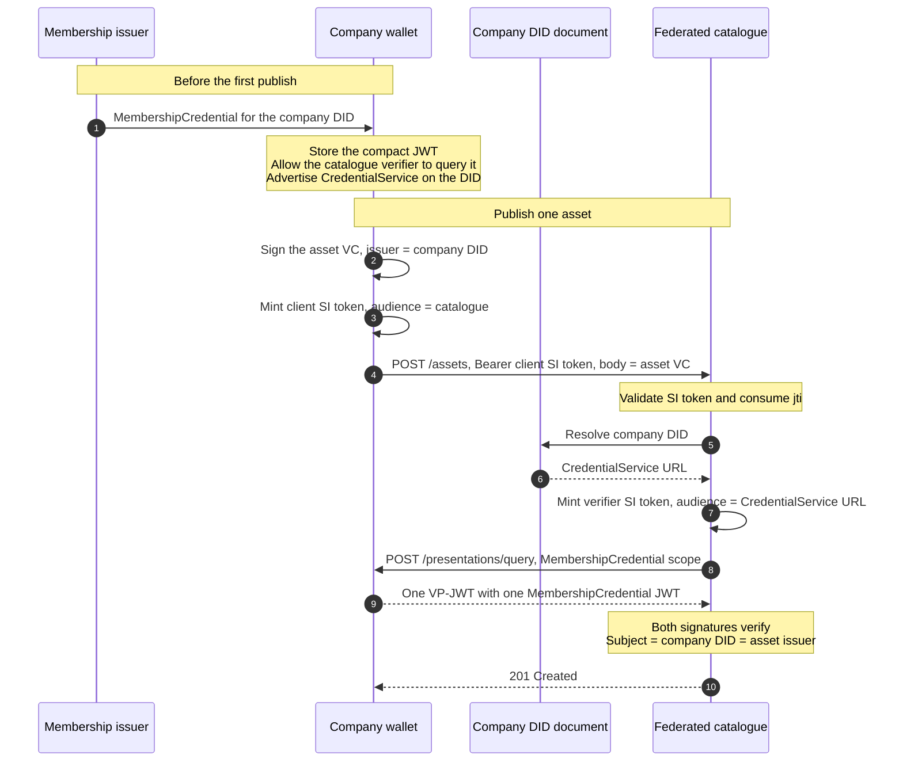

# Company wallet asset publish

The company wallet signs the asset and calls the catalogue. The catalogue then pulls the membership credential back from that same wallet before it stores anything. Machine authentication itself is described in [DCP machine authentication](dcp-asset-authentication.md).

`POST /assets` carries two separate things. The bearer token proves who is calling. The body is the asset credential. A `PresentationResponseMessage` is rejected.

Two credentials and two tokens stay separate.

| Piece | Who signs it | What it is |
|---|---|---|
| Membership credential | Membership issuer | Proof the company belongs. Stored in the wallet. Never sent as the asset. |
| Asset credential | Company wallet, `assertionMethod` | The `POST /assets` body. Issuer is the company DID. |
| Client SI token | Company wallet, `capabilityInvocation` | `Authorization` on `POST /assets`. Audience is the catalogue. |
| Verifier SI token | Catalogue | `Authorization` on the presentation query. Audience is the wallet Credential Service URL. |

## Where each value is set

The same identifier has to appear on both sides. The wallet does not have a catalogue client yet, so the two catalogue values in the wallet column are settings that client must receive.

| Value | Company wallet | Federated catalogue |
|---|---|---|
| DCP switched on | `wallet.protocol.dcp.enabled=true` | Already required for machine calls |
| Public wallet host | `wallet.protocol.dcp.base-domain` | Must be able to resolve the company `did:web` and call `https://{base-domain}/api/dcp/cs/{did}/presentations/query` |
| Company DID | Holder of the DCP key and subject of the membership credential | SI `sub`, membership subject, and asset issuer must all be this DID |
| Catalogue audience | Audience of the client SI token | `FEDERATED_CATALOGUE_DCP_AUDIENCE`, exact string match |
| Catalogue verifier DID | Presentation access rule: allow this DID to request `MembershipCredential` | `FEDERATED_CATALOGUE_DCP_VERIFIER_DID` |
| Catalogue signing key | Nothing. The wallet only checks the verifier token | `FEDERATED_CATALOGUE_DCP_VERIFIER_SIGNING_KEY`, a `capabilityInvocation` key on the verifier DID |
| Membership issuer DID | Issuer of the stored `MembershipCredential` | `FEDERATED_CATALOGUE_DCP_POST_ASSETS_REQUIRED_ISSUER` |
| Membership query | Answer `org.eclipse.dspace.dcp.vc.type:MembershipCredential` with one VP-JWT | Stored `POST_ASSETS` query for that scope |
| DCP key | Ed25519, shared with controller `dcp`, purposes `authentication` and `capabilityInvocation` | Resolved from the company DID document |
| Asset signing key | `assertionMethod` on the company DID | Used when the catalogue verifies the uploaded credential |

An empty wallet access list denies the pull. The DID document only advertises `CredentialService` while DCP is enabled and the catalogue resolves the document from the wallet.

The catalogue accepts exactly one VP-JWT containing exactly one signed `MembershipCredential` JWT (compact JWT or enveloped `vc+jwt`). Both signatures must verify. The membership subject, the SI subject, and the asset issuer must be the same company DID. Send the asset as `application/vc+jwt` or `application/vc+ld+json`.
